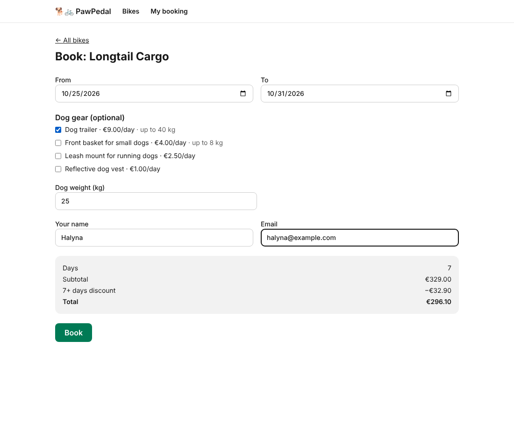

# PawPedal 🐕🚲

Rent a bike **together with the right gear for your dog** — a trailer for a big dog, a front basket for a small one,
a leash mount for a dog that runs alongside.

- Pick a bike, dates and gear and see the exact price before you book (7+ days: 10 % off).
- Gear that cannot fit the bike is disabled, with the reason ("Needs a bike with a trailer hitch").
- Book without an account and get a reference. Later, look it up with the reference and your email and cancel it.
- Availability is checked per bike and per gear unit. Two people cannot both get the last trailer.



## Run it

```bash
pnpm install
pnpm dev            # http://localhost:3000
```

No accounts, API keys or database are needed. Bookings are stored in `.data/bookings.json` (gitignored), and the
catalog is in `data/catalog.json`.

## Check it

```bash
pnpm check          # typecheck + lint + 53 tests
pnpm verify         # the above + a next build that must have zero warnings
```

End-to-end acceptance (spec §8) runs in a real browser with Playwright:

```bash
pnpm build && pnpm start -p 3210 &
node scripts/acceptance.mjs        # writes docs/runs/acceptance-run.md + screenshots
```

## How it is built

| | |
|---|---|
| What to build | [`docs/spec.md`](docs/spec.md) — requirements R1–R6 with IDs, committed before any code, with a changelog |
| Order of work | [`docs/plan.md`](docs/plan.md) |
| Who decided what | [`docs/decisions.md`](docs/decisions.md) — trust level per step, and what went wrong |
| Rules for coding agents | [`AGENTS.md`](AGENTS.md) |
| Agent guard-rails | `.claude/hooks/guard-env.mjs` blocks `.env*`; `.claude/hooks/log-action.mjs` logs every agent tool call to `.agent-log/actions.jsonl` (committed on purpose) — `pnpm agent:log`, `pnpm hooks:test` |
| Build loop | `scripts/loop.sh` (`pnpm loop "<goal>"`): gate → fresh headless agent → repeat. Run logs in [`docs/runs/`](docs/runs/) |
| Independent review | `.claude/agents/reviewer.md` + `scripts/review.sh` (`pnpm review`): a separate read-only agent session. Reports in [`docs/reviews/`](docs/reviews/) |

### Layout

```
lib/        pure domain logic — pricing, rules, availability, refs (no React, no I/O, no clock)
server/     catalog + file store with serialized transactions
app/api/    thin route handlers: catalog, quote, bookings, bookings/[ref], bookings/[ref]/cancel
app/        pages: bike list, /book/[bikeId], /booking
```

Stack: Next.js 16 (App Router), React 19, TypeScript, Tailwind CSS 4, Vitest, Testing Library.
